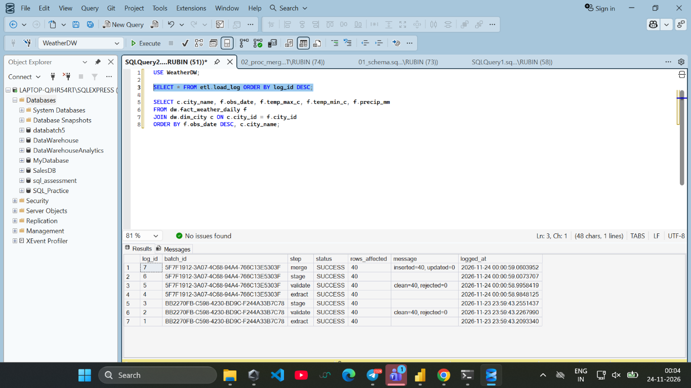
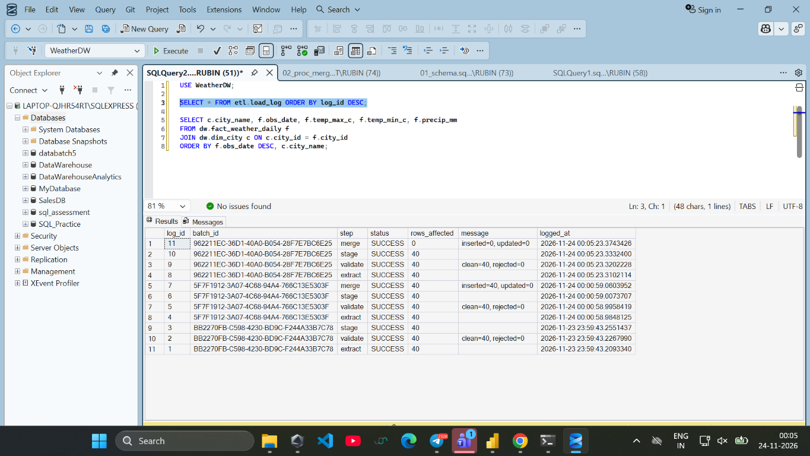

# weather_ETL

## Weather and Air Quality ETL Pipeline (Python + SQL Server)

An automated ETL pipeline that pulls weather and air-quality data for five
South Indian cities from the free [Open-Meteo APIs](https://open-meteo.com/),
validates it in Python, and loads it into SQL Server using staging tables and
incremental `MERGE` upserts. Air-quality readings are hourly in staging and
aggregated into daily PM10, PM2.5, and US AQI metrics. Every run is logged, and
invalid rows are quarantined.

## Architecture

```
Open-Meteo Weather API  -> Python -> staging.weather_daily -> weather MERGE
Open-Meteo Air Quality  -> Python -> staging.air_quality_hourly
                                             |
                                  air-quality MERGE (daily aggregates)
                                             |
                dw.fact_weather_daily + dw.fact_air_quality_daily
                                  \       /
                        dw.vw_city_daily_environment

Monitoring: etl.load_log; weather and air-quality rejected-row tables
```

## Key features

- **Incremental load:** `MERGE` inserts new days and updates revised values; re-runs are safe (idempotent).
- **Air-quality metrics:** daily average PM10 and PM2.5, daily maximum PM2.5 and US AQI, plus the number of hourly readings used.
- **Data validation:** rejects missing dates/times, missing PM10 or PM2.5, invalid temperatures, out-of-range values, and negative measurements; removes duplicates.
- **Monitoring:** step-by-step run log with row counts and error messages.
- **Analysis view:** `dw.vw_city_daily_environment` joins weather and air-quality facts by city and date.
- **Error handling:** transaction + `TRY...CATCH` in T-SQL, errors re-thrown with `THROW`; script exits non-zero on failure.
- **Automation:** `run_etl.bat` scheduled with Windows Task Scheduler.

## Setup

1. Install SQL Server (Express is fine), SSMS, and the *ODBC Driver 17 (or 18) for SQL Server*.
2. Run `sql/01_schema.sql`, `sql/02_proc_merge_weather.sql`, and
   `sql/03_air_quality.sql` in SSMS, in that order.
3. `pip install -r requirements.txt`
4. Set the server name if it is not `localhost\SQLEXPRESS`:
   `set SQL_SERVER=YOUR-PC\SQLEXPRESS` (and `SQL_DRIVER` if you use Driver 18).
5. `python etl.py`

## Check the results

```sql
SELECT * FROM etl.load_log ORDER BY log_id DESC;       -- run history
SELECT * FROM etl.rejected_rows;                        -- quarantined rows
SELECT * FROM etl.rejected_air_quality_rows;            -- rejected PM/AQI readings
SELECT c.city_name, f.obs_date, f.temp_max_c, f.precip_mm
FROM dw.fact_weather_daily f JOIN dw.dim_city c ON c.city_id = f.city_id
ORDER BY f.obs_date DESC, c.city_name;
SELECT * FROM dw.vw_city_daily_environment
ORDER BY obs_date DESC, city_name;
```

Run `python etl.py` twice: the second run should show `inserted=0` (or only a
few `updated`) in both the `merge` and `merge_air` log rows, which proves the
loads are incremental.

To inspect missing-PM10 rejections, query by rejection ID or timestamp rather
than assuming a row position; rejected records are stored separately from
accepted readings:

```sql
SELECT reject_id, city_name, obs_time, pm10, pm2_5, reason
FROM etl.rejected_air_quality_rows
WHERE reason LIKE '%missing_pm10%'
ORDER BY reject_id DESC;
```

`sql/04_analysis_queries.sql` contains example queries for comparing city
averages, checking rainy versus dry days, and ranking daily AQI. Air-quality
values come from the [Open-Meteo Air Quality API](https://open-meteo.com/en/docs/air-quality-api).

## SQL setup checkpoint

The air-quality setup scripts were applied and verified in `WeatherDW` on
2026-11-24:

| Check | Result |
| --- | --- |
| Air-quality staging table, rejected-rows table, daily fact table, merge procedure, and combined view | Created |
| Existing weather rows in the combined view | 45 |
| Air-quality fact rows | 0 (run `python etl.py` to load them) |
| Rejected air-quality rows | 0 |

## Screenshots

Successful pipeline run in the terminal:


SQL Server load log after the first successful load:



Load log after rerunning the pipeline, showing the idempotent merge:



Sample rows returned from the weather fact table:


Troubleshooting history showing an initial missing-procedure error followed by
successful runs:


## Scheduling (Windows Task Scheduler)

Create a Basic Task -> Daily -> Start a program -> `run_etl.bat`.

## Possible extensions

- Power BI / Tableau dashboard on `dw.fact_weather_daily`
- Add more cities or variables (humidity, wind)
- Email or alert when a step fails
