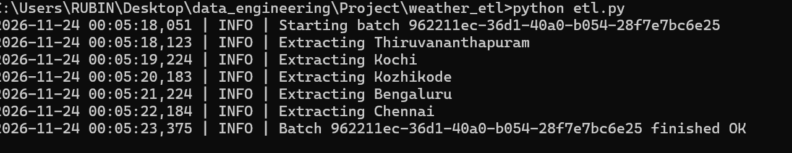
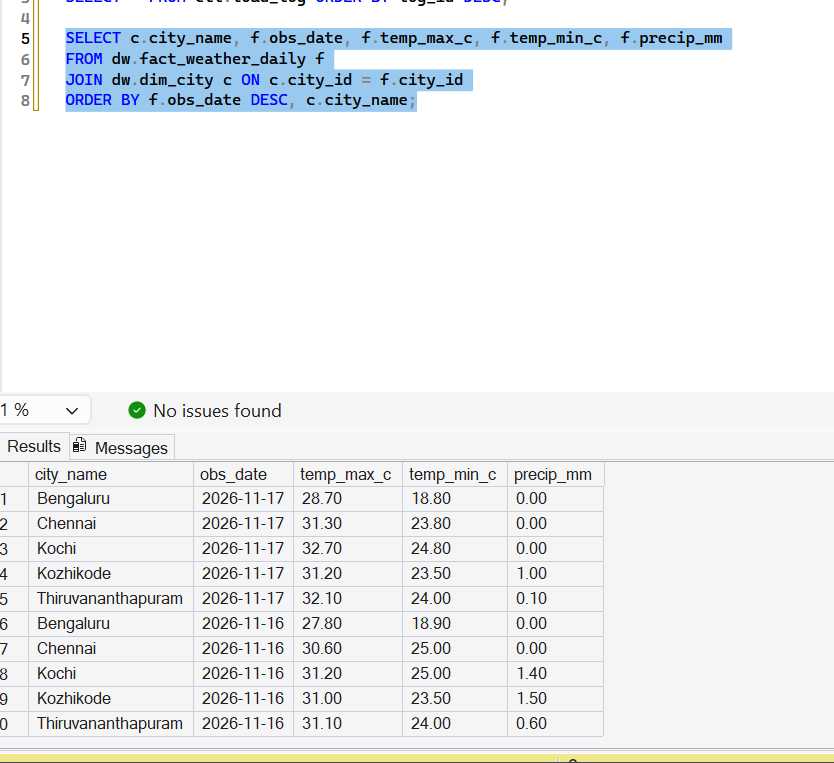
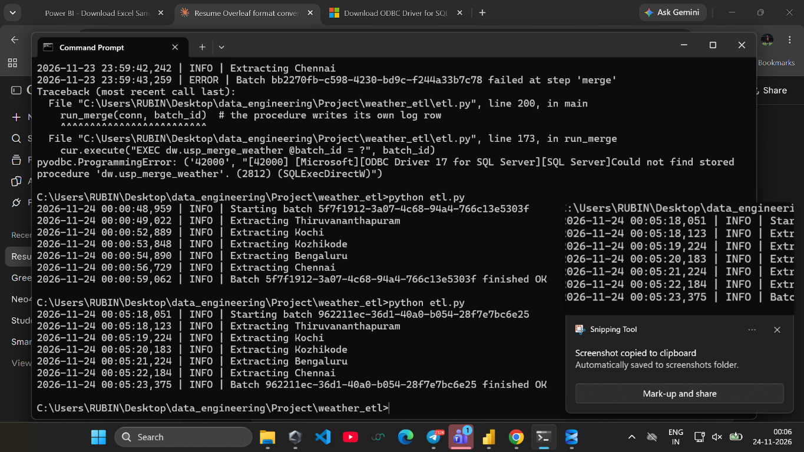

# weather_ETL

## Automated Weather ETL Pipeline (Python + SQL Server)

An automated ETL pipeline that pulls daily weather data for five South Indian
cities from the free [Open-Meteo](https://open-meteo.com/) API, validates it in
Python, and loads it into SQL Server using staging tables and an incremental
`MERGE` upsert. Every run is logged, and invalid rows are quarantined.

## Architecture

```
Open-Meteo API  ->  Python (extract, validate)  ->  staging.weather_daily
                                                         |
                                          dw.usp_merge_weather (MERGE)
                                                         |
                                  dw.fact_weather_daily  +  dw.dim_city

Monitoring: etl.load_log (every step)   etl.rejected_rows (bad data)
```

## Key features

- **Incremental load:** `MERGE` inserts new days and updates revised values; re-runs are safe (idempotent).
- **Data validation:** rejects missing dates, min > max temperature, out-of-range values and negative rainfall; removes duplicates.
- **Monitoring:** step-by-step run log with row counts and error messages.
- **Error handling:** transaction + `TRY...CATCH` in T-SQL, errors re-thrown with `THROW`; script exits non-zero on failure.
- **Automation:** `run_etl.bat` scheduled with Windows Task Scheduler.

## Setup

1. Install SQL Server (Express is fine), SSMS, and the *ODBC Driver 17 (or 18) for SQL Server*.
2. Run `sql/01_schema.sql`, then `sql/02_proc_merge_weather.sql` in SSMS.
3. `pip install -r requirements.txt`
4. Set the server name if it is not `localhost\SQLEXPRESS`:
   `set SQL_SERVER=YOUR-PC\SQLEXPRESS` (and `SQL_DRIVER` if you use Driver 18).
5. `python etl.py`

## Check the results

```sql
SELECT * FROM etl.load_log ORDER BY log_id DESC;       -- run history
SELECT * FROM etl.rejected_rows;                        -- quarantined rows
SELECT c.city_name, f.obs_date, f.temp_max_c, f.precip_mm
FROM dw.fact_weather_daily f JOIN dw.dim_city c ON c.city_id = f.city_id
ORDER BY f.obs_date DESC, c.city_name;
```

Run `python etl.py` twice: the second run should show `inserted=0` (or only a
few `updated`) in the `merge` log row, which proves the load is incremental.

## Screenshots

Successful pipeline run in the terminal:



SQL Server load log after the first successful load:


Load log after rerunning the pipeline, showing the idempotent merge:


Sample rows returned from the weather fact table:



Troubleshooting history showing an initial missing-procedure error followed by
successful runs:



## Scheduling (Windows Task Scheduler)

Create a Basic Task -> Daily -> Start a program -> `run_etl.bat`.

## Possible extensions

- Power BI / Tableau dashboard on `dw.fact_weather_daily`
- Add more cities or variables (humidity, wind)
- Email or alert when a step fails
